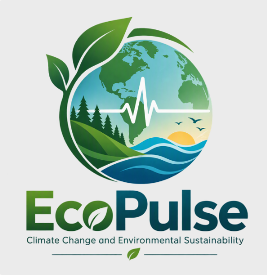

# Environmental Trends & Sensor Monitor

A data-analysis project exploring environmental change and air pollution using
country-year records from `global_climate_impact_1990_2025.csv`. The project
includes data cleaning and feature creation, exploratory analysis, predictive
modeling, and a Streamlit dashboard for communicating trends.

> **Data interpretation:** The supplied CSV contains annual country-level
> observations for 1990–2025. Its provenance and measurement methods should be
> verified before treating values as official monitoring results. The dataset
> is not a source of live sensor data.

## Contents

| File | Purpose |
|---|---|
| [`app.py`](./app.py) | Interactive Streamlit dashboard with historical views, sensor CSV upload, and public-awareness information. |
| [`transform_data.py`](./transform_data.py) | Cleans country-year rows, handles missing values, adds monitoring features, and encodes continent and region. |
| [`jupyter_notebooks/environmental_data_analysis.ipynb`](./jupyter_notebooks/environmental_data_analysis.ipynb) | Exploratory data analysis of pollution and climate indicators. |
| [`jupyter_notebooks/data_visualisation.ipynb`](./jupyter_notebooks/data_visualisation.ipynb) | Extended charts for communicating trends, coverage, regional variation, and health associations. |
| [`jupyter_notebooks/predictive_modeling.ipynb`](./jupyter_notebooks/predictive_modeling.ipynb) | Time-ordered next-year PM2.5 and temperature-anomaly prediction experiments. |
| [`global_climate_impact_1990_2025.csv`](./global_climate_impact_1990_2025.csv) | Supplied source dataset. |

## Run the dashboard

**Live dashboard:** [Open the Environmental Trends & Sensor Monitor](https://climate-change-1990-2025-app-b2df3a2baf60.herokuapp.com/)

From the project root, install the requirements and start Streamlit:

```powershell
python -m pip install -r requirements.txt
python -m streamlit run app.py
```

Use the sidebar to filter the historical data by years and continent. The
dashboard includes historical particulate trends and coverage, recent
continent and country comparisons, climate and emissions context, and an
exploratory PM2.5/respiratory-disease relationship. Downloadable country
summaries are provided for sharing and follow-up.

### Sensor CSV upload

The **Sensor data** tab accepts a CSV export with a `timestamp` or `datetime`
column, and one or more pollutant columns named `pm2_5`, `pm25`, `pm10`, `no2`,
or `ozone` (unit suffixes such as `_ug_m3` are also accepted). An optional
`site` column identifies monitoring locations.

Example:

```csv
timestamp,site,pm2_5,pm10
2025-06-01 09:00:00,School North,8.2,14.5
2025-06-01 10:00:00,School North,4.1,18.0
```

Uploaded sensor readings can be viewed during the app session and downloaded
as a cleaned CSV. The app does **not** connect to live sensors, automatically
refresh from IoT devices, or persist readings to a project database. If the
app is hosted online, review the hosting provider's file and session retention
settings before uploading sensitive or location-identifying information.

## Dashboard design and communication

The dashboard is intended for both general audiences and people who need to
inspect the underlying measures:

- **A guided story:** the interface separates historical trends, uploaded
  sensor data, and public-awareness/collaboration resources into tabs. It moves
  from high-level indicators to regional comparisons and then supporting
  context.
- **Plain-language summaries:** metric cards summarize the selected countries,
  latest available year, average PM2.5, and observed countries above a guideline
  reference. Captions explain what the numbers do and do not represent.
- **Charts with context:** labelled trend charts show particulate levels and
  reporting coverage; regional charts and tables allow country comparisons;
  climate and CO2 are kept separate because they use different units and
  describe different measures.
- **Technical detail:** users can inspect country values, sensor readings,
  reporting counts, correlations, and downloadable CSV summaries. The analysis
  notebooks provide further statistical outputs and model evaluation.
- **Accessible interpretation:** visualizations should identify units, time
  period, aggregation, missingness, and relevant thresholds in labels or
  explanatory text. The WHO 2021 annual guideline reference values used in the
  project are 5 µg/m³ for PM2.5 and 15 µg/m³ for PM10. Comparing short-interval
  sensor readings with annual guidelines is not an annual compliance test.
- **Narrative, not alarmism:** use charts to identify patterns and questions
  for follow-up, not to imply that country-level averages describe an
  individual's exposure or health risk.

## Current analysis snapshot

The supplied file has **6,948 country-year rows** for **193 countries** from
**1990 through 2025**, with no duplicate country-year keys in the inspected
dataset. Some pollution readings are missing: PM2.5 is missing in 496 rows
(7.14%) and PM10 in 501 rows (7.21%).

Among countries with 2025 PM2.5 observations, the observed country mean is
19.82 µg/m³; 182 of 192 reported values exceed the WHO annual guideline
reference. This is a count of country records, **not** a population exposure
estimate. In the notebooks' exploratory country averages, PM2.5 decreases
from 24.70 µg/m³ in 1990 to 19.82 µg/m³ in 2025, while the number of countries
with reported PM2.5 grows from 124 to 192. The changing coverage means that
this trend should not be interpreted as a like-for-like comparison without
further analysis.

The predictive notebook evaluates one-year-ahead models with chronological
training, validation, and 2020–2025 holdout periods. In the recorded run:

| Outcome | Model | Holdout MAE | Persistence MAE | Holdout R² |
|---|---|---:|---:|---:|
| PM2.5 | Ridge regression | 3.372 µg/m³ | 3.319 µg/m³ | 0.881 |
| Temperature anomaly | Ridge regression | 0.085 °C | 0.087 °C | 0.687 |

The PM2.5 ridge model did not outperform the persistence baseline on holdout
MAE, so the more complex model should not be presented as better for that
target. The temperature result is a historical country-level modeling result,
not a local forecast. Neither predictive associations nor the exploratory
correlation with respiratory disease establish causation.

## Ethical, legal, and social considerations

### Privacy and data handling

The supplied dataset is structured at country-year level and the inspected
columns do not contain names or direct personal identifiers. This reduces
direct privacy risk but does not prove that the data is anonymous, accurate,
licensed for every use, or free from re-identification risk when combined
with other information.

Sensor uploads can contain precise timestamps, site names, or sensitive
locations even when they contain no personal names. Do not upload personal
data, household-level readings, or sensitive site information unless there is
a clear purpose, an approved legal basis, appropriate safeguards, and
authorization from the responsible organization. Minimize collected fields,
restrict access, define a retention period, and remove or aggregate precise
location details before public sharing. Review hosting-provider storage,
logging, backups, and deletion behavior; the app's in-session handling is not a
substitute for a deployment privacy review.

### Bias, fairness, and representation

- Country-level averages weight each country equally rather than each person.
  Small and large populations therefore contribute equally to these summaries.
- Missing measurements are unevenly distributed over time and indicators.
  Countries with less complete monitoring may be underrepresented in rankings
  and trends.
- National averages hide differences between neighborhoods, urban and rural
  areas, age groups, and communities with different exposure or vulnerability.
- Sensor locations and calibration can introduce selection and measurement
  bias. An uploaded reading is not automatically comparable across devices or
  sites.
- Threshold comparisons are screening aids. They must not be used to label or
  penalize a community or country without validated, representative evidence
  and appropriate context.

### Legal and social implications

GDPR applicability depends on the data, purpose, processing roles, and
deployment context. Aggregate environmental measurements are not necessarily
personal data, but sensor records that identify or can reasonably be linked to
a person may be personal data. Before processing such data, an organization
should identify its controller/processor roles, lawful basis, transparency and
data-subject obligations, security and retention controls, international
transfer arrangements, and whether a data-protection impact assessment is
needed.

Environmental findings can affect public trust, property perceptions, and
policy decisions. Communicate uncertainty, source limitations, units, and
coverage alongside findings. Avoid causal or health claims unsupported by the
analysis, and provide accessible explanations for non-technical audiences.

## User testing and feedback

The dashboard has been smoke-tested with Streamlit's app testing tools,
including a valid sensor CSV upload and an invalid upload schema. **Formal
testing sessions with representative end users and feedback-driven revisions
have not yet been recorded.** They are a recommended next phase.

Suggested feedback session:

1. Recruit a small, varied group: community/public users, environmental
   practitioners, and a technical reviewer. Do not collect unnecessary
   participant personal data.
2. Ask participants to complete tasks: find the latest PM2.5 summary, explain
   the coverage chart, compare two continents, upload a sample sensor CSV, and
   identify what the results cannot conclude.
3. Observe task completion, errors, time-to-answer, and misunderstandings.
   Ask whether labels, units, color choices, keyboard use, and explanations
   are clear.
4. Record anonymized notes, prioritize fixes by user impact, update the
   dashboard, and retest the changed tasks.

Do not describe this testing as completed until sessions and resulting changes
have actually taken place.

## Project lifecycle plan

| Phase | Status | Tasks and milestone |
|---|---|---|
| 1. Scope and data inventory | Completed | Identify the environmental monitoring goal, inspect CSV fields, year coverage, and country-year key. Confirm dataset provenance and usage terms as an additional validation task. |
| 2. Data quality and transformation | Implemented; further validation planned | Normalize and validate country-year rows, handle missing values, create features, and retain missingness flags in `transform_data.py`. Review imputation choices and missingness by region before operational use. |
| 3. Exploratory analysis | Implemented | Explore pollution, climate, coverage, geography, and descriptive health associations in the EDA notebooks. |
| 4. Predictive modeling | Implemented as an experiment | Train time-ordered PM2.5 and temperature-anomaly models, tune with validation years, and compare the later holdout with persistence. Improve PM2.5 modeling only if it can beat a simple baseline reliably. |
| 5. Dashboard and communication | Implemented | Build historical visualizations, metric summaries, filters, sensor CSV upload, downloads, and public-awareness guidance in `app.py`. |
| 6. Verification and accessibility | Partially completed | Smoke-test dashboard rendering and upload validation. Add keyboard/screen-reader and chart-label review, broader malformed-file tests, and deployment checks. |
| 7. User feedback | Planned | Run the feedback sessions above with technical and non-technical users; document findings and prioritize revisions. |
| 8. Sensor/partner integration | Planned; requires stakeholder agreement | Consult environmental organizations or monitoring experts about sensor calibration, metadata, representativeness, data sharing, governance, and practical response workflows. No live IoT connection currently exists. |
| 9. Release and maintenance | Planned | Validate data updates and provenance, review privacy/security controls, publish release notes, monitor model errors if refreshed data becomes available, and schedule periodic review. |

### Challenges and reflections

- **Incomplete and changing coverage:** PM2.5 and PM10 have missing observations,
  and PM2.5 reporting coverage differs substantially between 1990 and 2025.
  Trend charts therefore include reporting counts and caveats.
- **No live sensor source:** the project CSV is annual and country-level. The
  dashboard accepts sample/exported sensor CSVs but does not connect to IoT
  hardware or verify sensor calibration.
- **Model benchmark:** the PM2.5 ridge model's holdout MAE was slightly worse
  than persistence. Comparing against a simple baseline prevented overstating
  the value of the more complex approach.
- **Dependency and runtime setup:** Streamlit was not in the original
  environment, so it was added to the dependency requirements and the app was
  smoke-tested after installation.
- **Time and scope:** this project does not document a measured schedule or
  user-study budget. Formal user feedback, provenance review, and operational
  monitoring remain future work rather than claimed accomplishments.

## Documentation and quality checks

Code modules and transformation functions include docstrings, and the notebooks
explain their modeling or analysis steps. The dashboard uses labels,
units, tooltips, captions, and explanatory text for key measures. Before each
release:

- Run the dashboard locally and check all tabs and filters.
- Test valid and invalid sensor CSVs and confirm error messages are clear.
- Check charts, keyboard navigation, color contrast, and chart descriptions
  with a technical and a non-technical reviewer.
- Recalculate headline values from the current source data and update this
  README when data or model results change.

## Credits

- WHO, [Global air quality guidelines](https://www.who.int/publications/i/item/9789240034228)
  (2021).
- GDPR, [Regulation (EU) 2016/679](https://eur-lex.europa.eu/eli/reg/2016/679/oj).
- **Dataset:** This project uses the Global Climate Impact 1990–2025 dataset
  from Kaggle, covering 193 countries and 94 climate, environmental, economic,
  and sustainability indicators from 1990 to 2025. The dataset combines real
  country information with synthetically generated time-series data designed
  to maintain realistic relationships between variables, making it suitable
  for data analysis, visualization, and machine-learning projects.
- **Dataset creator:** Muhammad Aamir, [Global Climate Impact 1990–2025 on
  Kaggle](https://www.kaggle.com/datasets/aamir28/global-climate-impact-1990-2025).
- **Local dataset file:** [`global_climate_impact_1990_2025.csv`](./global_climate_impact_1990_2025.csv).
- **Title image:** Screenshot from Microsoft 365 Copilot.
- **AI assistance:** GitHub Copilot and Microsoft 365 Copilot were used for AI
  assistance.
- **Learning:** The Code Institute LMS was used for learning.

## Acknowledgements

Thank you to the Code Institute instructors and learning community for their
guidance and learning resources throughout this project.